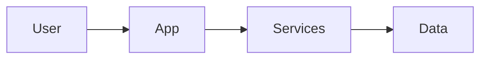

# High-Level Architecture

Describe the system at the level a new technical advisor needs in 15 minutes. Implementation detail lives in your code repository, not here.

## System overview

[Short description. Optionally embed a diagram: Mermaid is rendered by GitHub.]

## Components

| Component | Responsibility | Build / buy / open source | Owner |
|---|---|---|---|
| [TBD] | | | |

## Key technology choices

Record each significant choice as an ADR in [adr/](adr/) and link it here.

| Choice | ADR | Status |
|---|---|---|
| [TBD] | | |

## Data flow and trust boundaries

What data enters, where it is stored, who can access it, and what crosses an organizational boundary? [TBD]

## Scalability and failure modes

- Expected first bottleneck: [TBD]
- Single points of failure: [TBD]

## Security and privacy posture

[TBD: authentication, encryption, data residency, compliance targets.] Do not document secrets or internal endpoints here.

## Technical debt and known gaps

- [TBD]
