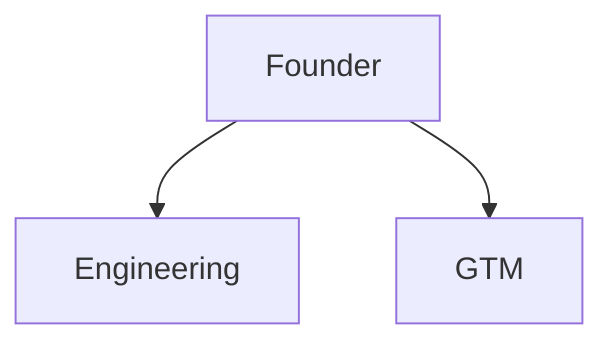

# Hiring Roadmap

## Capability gaps

What can the current team not do that blocks the next milestone? [TBD]

## Hires and engagements

| Role | Why now (milestone it unblocks) | Full-time / contract / advisor | Target start | Status |
|---|---|---|---|---|
| [TBD] | | | | |

## Advisory board

| Advisor | Expertise | What we ask of them | Engagement terms location |
|---|---|---|---|
| [TBD] | | | `[EXTERNAL: ...]` |

## Hiring principles

- [TBD]

## Org chart (next 12 months)

## Compensation approach

Philosophy only. Individual offers and salary data stay outside git.
